<picture>
  <source media="(prefers-color-scheme: dark)" srcset="art/banner-dark.svg">
  
</picture>

<p align="center">
  <a href="https://sweax3169.github.io/roblox-games/"><b>Open the site</b></a> ·
  <a href="https://sweax3169.github.io/roblox-games/?lang=tr">Türkçe site</a> ·
  <a href="#türkçe">README in Turkish</a> ·
  <a href="https://www.roblox.com/communities/740864436">Sweax Studios on Roblox</a> ·
  <a href="https://discord.gg/vGZ2DZZsrf">Discord</a>
</p>

The Roblox games of Sweax Studios in one place: a hub and a page for each game, in English and Turkish. Each page takes its look from its own game, every picture comes from the games themselves, and every number is read from the game's code or from Roblox's public API.

| Game | Status | Page | Play |
| --- | --- | --- | --- |
| **+1 Speed POP IT Escape** | Out on Roblox | [pop-it](https://sweax3169.github.io/roblox-games/pop-it/) | [roblox.com/games/109544000160812](https://www.roblox.com/games/109544000160812) |
| **Merge Ores** | Out on Roblox | [merge-ores](https://sweax3169.github.io/roblox-games/merge-ores/) | [roblox.com/games/108764513896843](https://www.roblox.com/games/108764513896843) |
| **RNG Zombie Defense** | Coming soon | [rng-zombie-defense](https://sweax3169.github.io/roblox-games/rng-zombie-defense/) | Not public yet; the date will be on [Discord](https://discord.gg/vGZ2DZZsrf) |

<br>

## The hub

<a href="https://sweax3169.github.io/roblox-games/">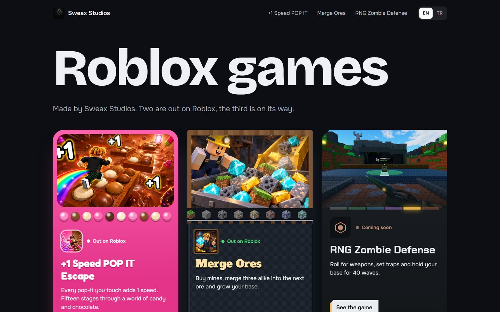</a>

Three windows, each built from its game's material. POP IT is pink silicone with a row of bubbles that pop in a wave. Merge Ores is stone blocks under a timber beam, with the ten ores riding a rail. RNG Zombie Defense is a graphite plate whose light cycles through the game's six rarity colours. They tilt toward the pointer, and each one arrives in its own way: the pop-it squishes in, the stone drops and settles, the graphite plate powers on.

## +1 Speed POP IT Escape

<a href="https://sweax3169.github.io/roblox-games/pop-it/">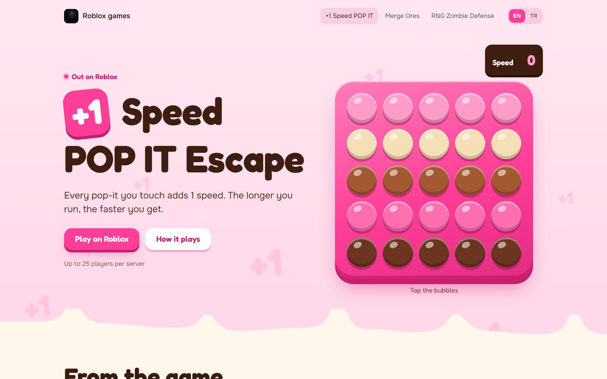</a>

Strawberry milk, pink silicone and chocolate, set in Fredoka.

- **A pop-it tray you can pop.** Every bubble adds 1 to the speed counter, like every pop-it you touch in the game. When the tray is empty it flips over and starts again, like the toy.
- **15 stages** drawn as a track. A runner crosses it and gets faster at each stage; the last stop is the boss.
- **The five store images** from Roblox in a gallery that opens them large.
- Sections are poured over each other as chocolate, and pale "+1"s drift up behind the title.

## Merge Ores

<a href="https://sweax3169.github.io/roblox-games/merge-ores/">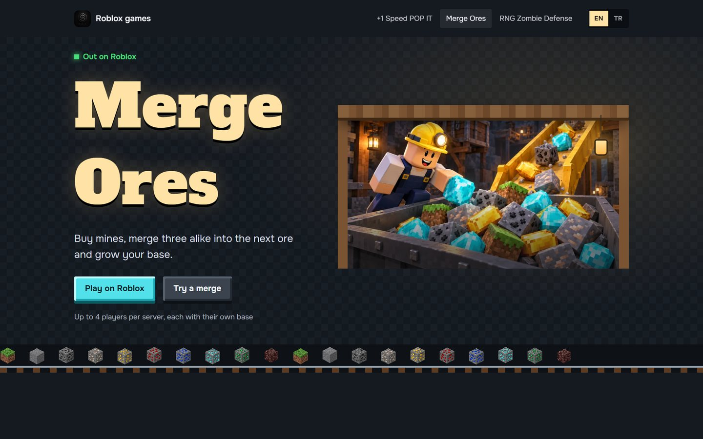</a>

A cool stone mine lit by a swinging lantern, set in Alfa Slab One. Buttons are ore blocks with a pixel bevel that sink when pressed.

- **A merge bench that follows the game's rule.** Add Grass mines; three alike merge into the next tier at the anvil, and a new set of three keeps the chain going, the same way the game's anvil cascades.
- **Ten ores as a staircase.** Each step is an ore with its value per ore, from $1 for Grass to $260K for Netherite, formatted the way the game formats money. Step heights follow the value on a log scale, in each ore's own colour.
- Ores ride a rail under the hero, and the three Roblox store images hang in timber frames.

## RNG Zombie Defense

<a href="https://sweax3169.github.io/roblox-games/rng-zombie-defense/">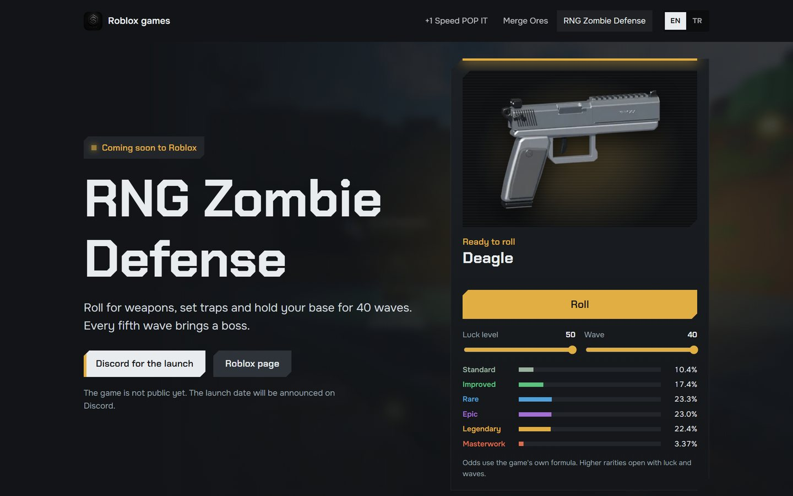</a>

The game's graphite interface: cut-corner plates, Chakra Petch, and one light that takes the colour of the last rarity rolled.

- **The roll, with the game's own odds.** The machine is a port of `RngConfig.GetTierOdds` and `GetOdds`. Move the luck level (1 to 50) and the wave (1 to 40) and the six rarity bars change exactly as they do in the game; locked rarities show when they open. Press Roll and the reel lands on a weapon with its real chance.
- **The 40-wave table.** One bar per wave in the colour of that wave's event, a white bar for each boss, and a marker that walks the road.
- **8 bosses, 12 wave events, 24 weapons in six rarities, 13 traps**, each with its in-game name and line in both languages.
- The roll chest, rendered in Blender, opens and closes; three frames from Roblox Studio show the base.

## On a phone

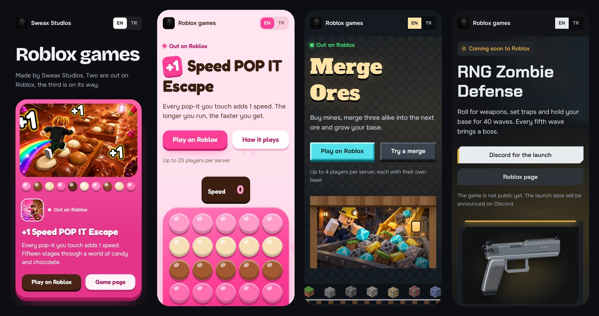

On phones the long rows (gallery, ore staircase, weapons, traps) become rows you swipe, so the page stays short.

<br>

## Where the numbers come from

Nothing on the site is typed in by hand. `tools/extract_rng.py` and `tools/extract_ores.py` read the games' Lua files into `data/*.json`, and `tools/build_data.py` turns those into the scripts the pages load.

| On the site | Value | Read from |
| --- | --- | --- |
| POP IT play link | place 109544000160812 | Roblox games API: universe 10533270212 → `rootPlaceId` |
| POP IT server size | 25 players | Roblox games API `maxPlayers` |
| POP IT stages, bosses, tsunami, secret room | 15 stages | the game's own description on Roblox |
| Merge Ores play link | place 108764513896843 | Roblox games API: universe 10716936544 → `rootPlaceId` |
| Merge Ores server size | 4 players | Roblox games API `maxPlayers` |
| Ore tiers, names, values, colours | 10 tiers, $1 to $260K | `Config.lua`: `MAKS_KADEME`, `kademe(...)` |
| Merge rule | 3 alike → next tier | `Kural.lua` (`adet >= 3`), `Loc.lua` "Merge 3 alike" |
| Waves and boss waves | 40; bosses at 5, 10 … 40 | `DefenseBalance.lua`: `MaxWave`, `BossWaves` |
| Boss names (EN/TR) | 8 | `DefenseBalance.lua` + `LangTables/source.lua` |
| Wave events and which wave gets which | 12; none on waves 1, 2 and boss waves | `WaveEventInfo.lua`, `DefenseBalance.lua` `Waves` |
| Weapons and rarity pools | 24 in 6 rarities | `DefenseBalance.lua` `WeaponShop`, `RngConfig.lua` `TierPools` |
| Traps | 13 | `DefenseBalance.lua` `Traps`, `Localization.lua` |
| Roll odds | per luck and wave | `RngConfig.lua` `GetTierOdds`, `GetOdds` |
| Languages | 17 | `Shared/Lang.lua` |
| RNG Zombie Defense status | not public | Roblox games API returns no data for universe 10767768347 |

Visit counts are not shown: they change every day and a static page would go stale.

## Checked before release

`tools/check.js` runs inside each page and reports sideways scrolling, text cut off by its box, text that overlaps other text, and headings whose line height is smaller than the real height of Turkish letters. That last check measures `İ Ü Ö Ğ Ç Ş` above the line and `ç ş ğ y j` below it with `canvas.measureText`, in the actual font, instead of guessing.

| Font | Measured extent / size | Line height used |
| --- | --- | --- |
| Bricolage Grotesque (hub) | 1.13 | 1.15 |
| Fredoka (POP IT) | 1.17 | 1.2 |
| Alfa Slab One (Merge Ores) | 1.28 | 1.3 |
| Chakra Petch (RNG Zombie Defense) | 1.14 | 1.15 |

The check ran on 4 pages × 2 languages × 6 widths (1440, 1280, 1024, 768, 390, 360): 48 cases, all clean. The pages also load with no console errors, no broken images and no broken internal links. Motion follows `prefers-reduced-motion`; nothing pins the scroll, and the reveal-on-scroll only runs on wide screens and never hides content when scripts are off.

## Project layout

```
docs/                     the site (GitHub Pages serves this folder)
  index.html              hub
  pop-it/  merge-ores/  rng-zombie-defense/
  assets/css/             base + one stylesheet per page
  assets/js/              i18n, motion, one script per page, data-*.js (generated)
  assets/img/             store images, Blender renders, Studio captures (webp)
  assets/fonts/           self-hosted woff2 + OFL licences
data/                     rng.json, ores.json, extracted from the game source
tools/
  extract_rng.py          RNG Zombie Defense facts from the game's Lua
  extract_ores.py         Merge Ores tiers from Config.lua
  build_data.py           data/*.json → docs/assets/js/data-*.js
  build_img.py            builds every picture from the game folders
  check.js                the layout and glyph check above
  art.py                  the animated banner at the top of this README
art/                      banner and screenshots for this README
```

## Run it locally

```bash
python -m http.server 8793 --directory docs
```

Then open `http://localhost:8793/`. Add `?lang=tr` for Turkish; the choice is remembered.

## Credits

Games, images and site by Sweax Studios. Fonts: Bricolage Grotesque, Onest, Fredoka, Alfa Slab One and Chakra Petch, all under the SIL Open Font License 1.1 (licence files sit next to the fonts). Roblox is a trademark of Roblox Corporation; this site is not made or endorsed by Roblox.

<br>

---

<a name="türkçe"></a>

## Türkçe

Sweax Studios'un Roblox oyunları tek yerde: bir ana sayfa ve her oyuna bir sayfa, İngilizce ve Türkçe. Her sayfa görünüşünü kendi oyunundan alıyor, bütün görseller oyunların kendisinden geliyor, her sayı oyunun kodundan ya da Roblox'un herkese açık API'sinden okunuyor.

| Oyun | Durum | Sayfa | Oyna |
| --- | --- | --- | --- |
| **+1 Speed POP IT Escape** | Roblox'ta yayında | [pop-it](https://sweax3169.github.io/roblox-games/pop-it/?lang=tr) | [roblox.com/games/109544000160812](https://www.roblox.com/games/109544000160812) |
| **Merge Ores** | Roblox'ta yayında | [merge-ores](https://sweax3169.github.io/roblox-games/merge-ores/?lang=tr) | [roblox.com/games/108764513896843](https://www.roblox.com/games/108764513896843) |
| **RNG Zombie Defense** | Yakında | [rng-zombie-defense](https://sweax3169.github.io/roblox-games/rng-zombie-defense/?lang=tr) | Henüz herkese açık değil; tarih [Discord](https://discord.gg/vGZ2DZZsrf)'da duyurulacak |

### Ana sayfa

<a href="https://sweax3169.github.io/roblox-games/?lang=tr">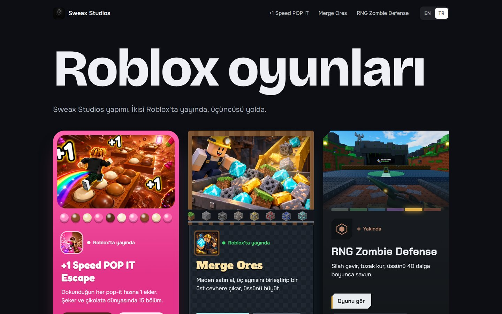</a>

Üç pencere, her biri kendi oyununun malzemesinden. POP IT pembe silikon ve dalga hâlinde patlayan kabarcıklar; Merge Ores ahşap kirişin altında taş bloklar ve rayda giden on cevher; RNG Zombie Defense ise ışığı oyunun altı nadirlik rengi arasında dönen grafit bir plaka. Pencereler fareye doğru eğilir ve her biri kendi biçiminde gelir: pop-it esneyerek, taş düşüp oturarak, grafit plaka ışığı yanarak.

### +1 Speed POP IT Escape

<a href="https://sweax3169.github.io/roblox-games/pop-it/?lang=tr">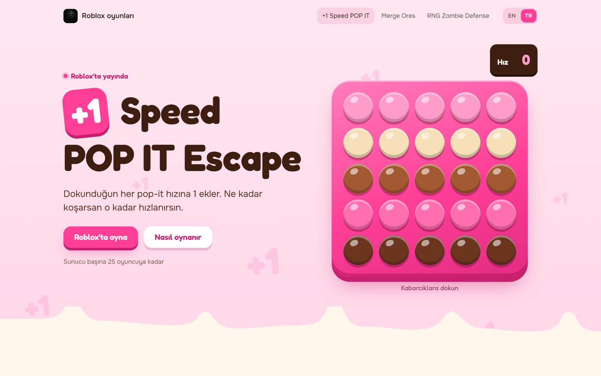</a>

- **Patlatılabilen pop-it tepsisi.** Her kabarcık hız sayacına 1 ekler, oyunda dokunduğun her pop-it gibi. Tepsi bitince oyuncaktaki gibi ters döner ve baştan başlar.
- **15 bölüm** bir yol olarak çizili; koşucu her bölümde biraz daha hızlanır, son durak boss.
- Roblox'taki **beş tanıtım görseli**, tıklayınca büyüyen bir galeride.

### Merge Ores

<a href="https://sweax3169.github.io/roblox-games/merge-ores/?lang=tr">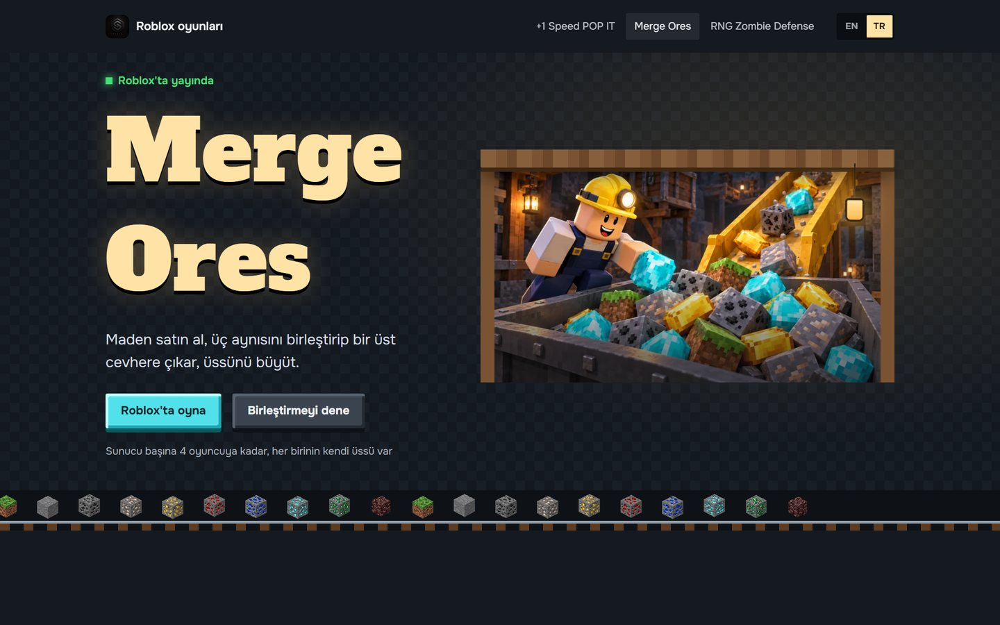</a>

- **Oyunun kuralıyla çalışan birleştirme tezgâhı.** Çimen madeni ekle; üç aynı maden örste bir üst kademeye birleşir, yeni üçlü oluşursa zincir oyundaki örs gibi devam eder.
- **On cevher, bir merdiven.** Her basamakta cevher başına değer: Çimen $1, Netherit $260K, oyunun para biçimiyle. Basamak yükseklikleri değere göre (logaritmik), her biri kendi cevher renginde.

### RNG Zombie Defense

<a href="https://sweax3169.github.io/roblox-games/rng-zombie-defense/?lang=tr">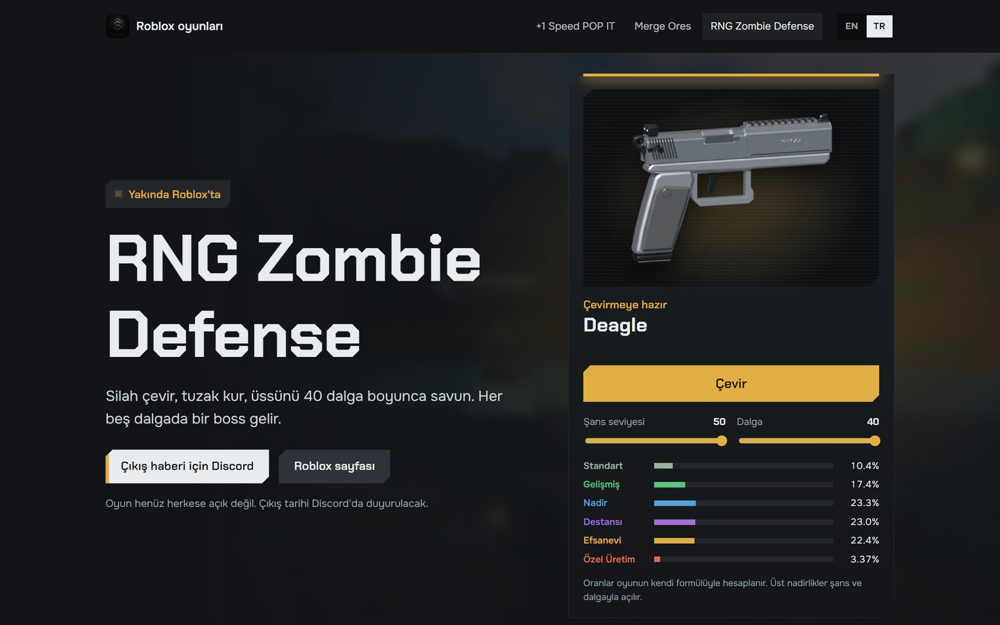</a>

- **Oyunun kendi olasılıklarıyla çevirme.** Makine `RngConfig.GetTierOdds` ve `GetOdds`'un birebir aktarımı. Şans seviyesini (1–50) ve dalgayı (1–40) değiştirince altı nadirlik oranı oyundakiyle aynı değişir; kilitli nadirliklerin ne zaman açıldığı yazar.
- **40 dalgalık tablo:** her dalga o dalganın olay renginde, her boss beyaz.
- **8 boss, 12 dalga olayı, altı nadirlikte 24 silah, 13 tuzak**, oyundaki adları ve açıklamalarıyla.

### Telefonda

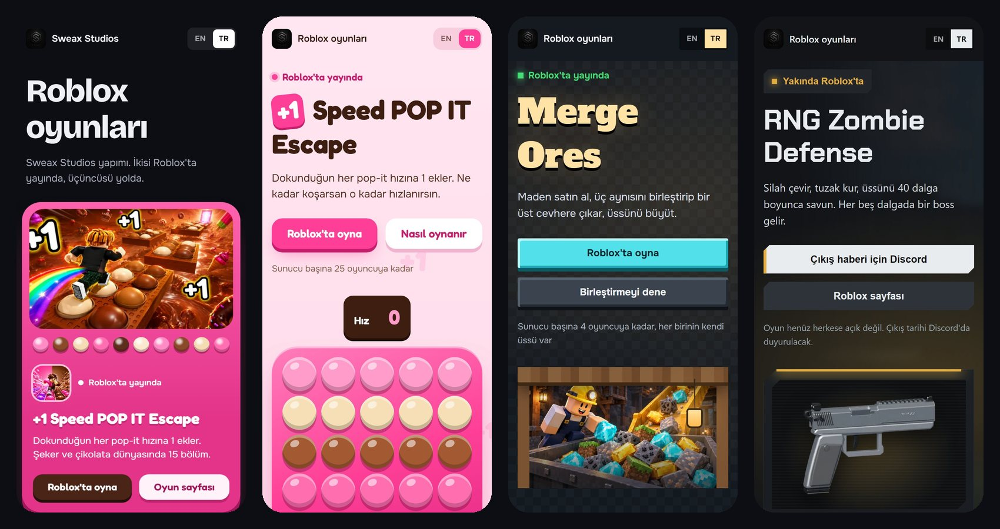

### Sayılar nereden geliyor

Sitede elle yazılmış sayı yok. `tools/extract_rng.py` ve `tools/extract_ores.py` oyunların Lua dosyalarını `data/*.json`'a okur, `tools/build_data.py` bunları sayfaların yüklediği betiklere çevirir. Kaynak tablosu yukarıdaki İngilizce bölümde. Ziyaret sayısı gösterilmiyor; her gün değişir ve sabit sayfada bayatlar.

### Yayından önce ölçülenler

`tools/check.js` her sayfanın içinde çalışıp yatay kaymayı, kutusundan taşan yazıyı, üst üste binen yazıyı ve satır aralığı Türkçe harflerin gerçek yüksekliğinden küçük olan başlıkları bulur. Son ölçüm tahmin değil: `İ Ü Ö Ğ Ç Ş` harflerinin üstü ve `ç ş ğ y j` harflerinin altı, sayfadaki yazı tipiyle `canvas.measureText` ile ölçülür. 4 sayfa × 2 dil × 6 genişlik (1440, 1280, 1024, 768, 390, 360) = 48 durumun hepsi temiz.

### Yerelde çalıştırma

```bash
python -m http.server 8793 --directory docs
```

Sonra `http://localhost:8793/?lang=tr` adresini aç.
